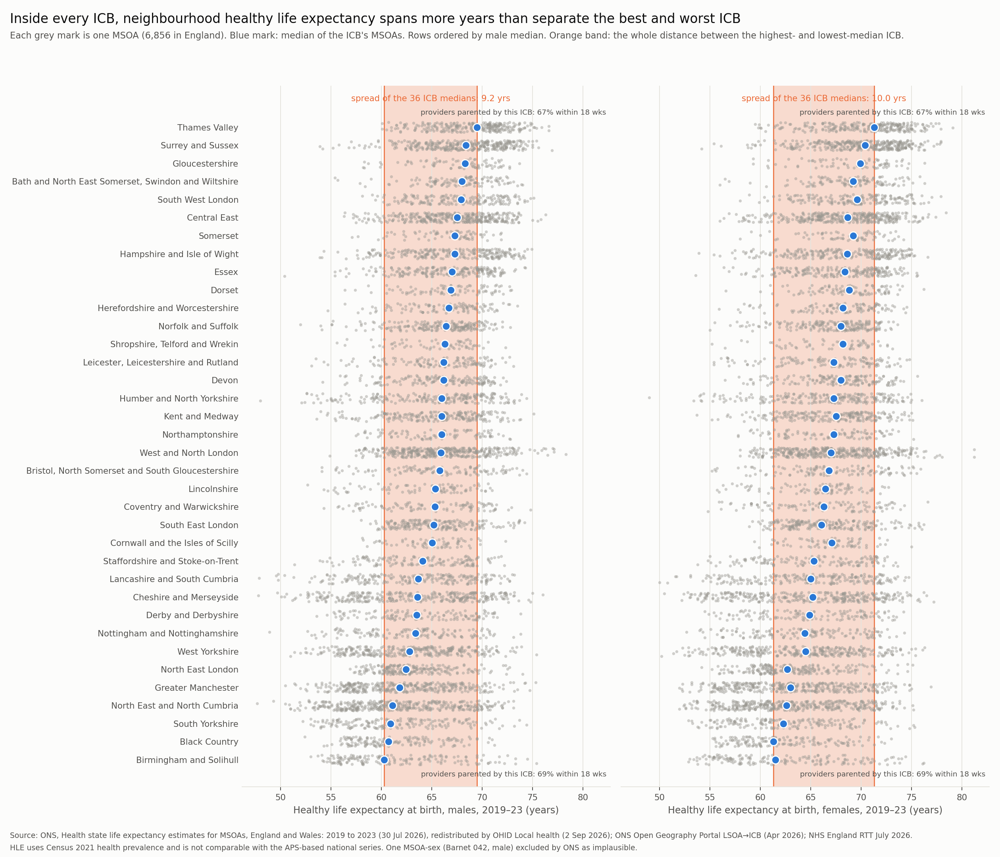

# Two Maps — healthy life expectancy by neighbourhood vs RTT waiting times by provider

A Bronze → Silver → Gold pipeline (Python, pandas, Parquet) built to test a
claim *before* writing about it: that England's two halves of the "postcode
lottery" — healthy life expectancy (HLE), published by where you live, and
RTT waiting-time performance, published by where you are treated — cannot be
cleanly joined, and that the failure to join is itself the finding.

**Short version of what the data said:** one of the three claims holds
outright, one is false as stated and true in a more useful form, and the
third is answered by a number rather than an assumption. Details in
[docs/findings.md](docs/findings.md).

## Sources (all open data, all in `data/bronze/*/metadata.json` with SHA-256)

| Source | What | Grain | Date |
|---|---|---|---|
| ONS, *Health state life expectancy estimates for MSOAs, England and Wales: 2019 to 2023* | HLE, DFLE, LE at birth by sex; Census 2021 health prevalence, Sullivan method | MSOA (2021) | 30 Jul 2026 |
| OHID Local health (Fingertips), indicator 94359 | The same HLE, as redistributed by OHID | MSOA (2021) | 2 Sep 2026 |
| NHS England, RTT full CSV extracts, April–July 2026 | Incomplete pathways by weekly wait band | provider × commissioner × treatment function | monthly, latest 10 Sep 2026 |
| ONS Open Geography Portal | LSOA21 → SICBL → ICB → NHSER → LAD (Apr 2026); OA21 → LSOA → MSOA (Apr 2023); LAD → Region (Dec 2024) | LSOA / OA / LAD | Apr 2026 |
| OHID, *NHS acute (hospital) trust catchment populations: April 2026* | Patients admitted by MSOA of residence × acute trust, with first-past-the-post flag; all / elective / emergency | MSOA (2021) × trust | 28 Apr 2026 |

## Reconciliation gate (`src/pipeline/03_reconciliation_gate.py`)

HLE is a life-table quantity, not an additive one, so "rebuild the England
figure" means three independent checks, all of which pass
(`data/gold/00_reconciliation/reconciliation.csv`):

- **A.** Fingertips England HLE = ONS England HLE: **65.1 (male), 66.5 (female)**, CIs identical.
- **B.** All 13,712 English MSOA × sex rows identical between Fingertips and ONS; the one MSOA-sex ONS excluded as implausible (Barnet 042, male, LE 97.1) is absent from both.
- **C.** The ONS bulletin's distribution statistics reproduce from the Silver rows: median 65.3 / 66.8, IQR 7.4 / 7.8, 10th–90th percentile 57.7–71.0 / 58.6–72.6. (One 0.1-year rounding artefact on the male interdecile range — ONS computes it from unrounded values — is tolerated and recorded, not hidden.)
- **D.** RTT (July 2026): 7.16m incomplete pathways, 65.3% within 18 weeks, 111,429 over 52 weeks from the extract, against 7.3m / 65.4% / 111,379 in the statistical press notice, which adds estimates for four non-submitting providers.

The Census-2021-based HLE (65.1) is **not** the APS-based national HLE that
is usually quoted (~61–62). ONS states they are not comparable.

## Pipeline

```
src/pipeline/
  01_bronze_ingest.py          five raw sources, unmodified, with provenance
  02_silver_hle.py             ONS and Fingertips HLE on one schema; grain MSOA × sex asserted
  03_reconciliation_gate.py    the gate above; exits non-zero on failure
  04_silver_geography.py       MSOA → LAD → region → SICBL → ICB → NHS region; ICB nesting asserted
  05_silver_rtt.py             period × provider RTT, April–July 2026; 18-week and 52-week shares rebuilt from bands
  06_silver_catchment.py       MSOA × trust admissions crosswalk; grain asserted
  07_gold_spread.py            within-ICB vs between-ICB HLE spread, by sex
  08_gold_crosswalk.py         four crosswalk routes attempted and measured
  09_gold_joined.py            what the join says once you make it
  10_gold_chart.py             the strip chart
  11_gold_months.py            the RTT-dependent results repeated for each of the four months
  12_gold_specialty.py         the national 18-week picture by treatment function
```

Run in order: `for f in src/pipeline/0*.py src/pipeline/1*.py; do python3 $f || break; done` — or follow the three notebooks in `notebooks/` (`01_bronze`, `02_silver`, `03_gold`), which run the same steps and inspect what each produced.

## Headline numbers (all reproducible from `data/gold/`)

- 6,856 English MSOAs; 36 ICBs (post-April-2026); 533 RTT providers of which 151 NHS trusts; 134 acute trusts in the catchment file.
- Spread of the 36 ICB medians: **9.2 years (male), 10.0 (female)**. Median within-ICB range: **20.3 / 20.5 years**. Narrowest ICB (Cornwall): 14.2 / 15.6. **All 36 ICBs** have an internal range, interdecile range *and* IQR wider than the corresponding between-ICB measure. 81–82% of MSOA HLE variance is within ICBs.
- A residence → trust crosswalk exists (OHID catchment file). The dominant trust takes a median **76%** of a neighbourhood's elective admissions (p10 52%, p90 91%); for 8.1% of MSOAs it takes under half. Using it as if it were clean changes a neighbourhood's 18-week figure by a median 0.8 pp, p90 3.0 pp, max 12.8 pp.
- Within a single **local authority** — the geography that matches "twenty minutes apart" — the median HLE range is **13.3 years (male) / 13.6 (female)** across the 277 LADs with at least ten MSOAs. 144 of them span 13 years or more internally. Widest: Wirral, 47.8 to 73.2 (male).
- No treatment function meets the 92% standard. Oral surgery is furthest from it: **54.2%** within 18 weeks in July 2026, 37.8 pp short (`data/gold/06_specialty/`).
- 7.1% of the national waiting list sits at providers with no residence footprint at all (403 of 533 providers, mostly independent sector). 228 MSOAs' dominant trust did not submit RTT data for July 2026.
- ICB footprints leak: **14.0%** of elective acute admissions are treated by a trust parented by a different ICB from the patient's; Staffordshire and Stoke-on-Trent 47%.
- Once joined, MSOA HLE and the dominant trust's 18-week share are uncorrelated: **r = −0.008 (male), −0.006 (female)** in July 2026; Spearman likewise. Across April–July 2026 the Pearson r never leaves the range −0.021 to −0.006 (`data/gold/05_months/by_month.csv`). Trusts in the worst-waiting quartile serve neighbourhoods with median HLE 65.8 (M) vs 65.0 for the best-waiting quartile.



## Re-running this

`pip install -r requirements.txt`, then the run line above. Bronze is not in
git — the raw payloads are re-downloaded from the URLs in each
`metadata.json`, and the recorded SHA-256 tells you whether you got the same
bytes I did.

One caveat on that: NHS England publishes each month's RTT extract at a URL
with a random suffix (`…Full-CSV-data-file-Jul26-ZIP-4M-97ylx5.zip`), and
those links are rotated and retired. If Bronze ingest 404s on the RTT
sources, the file has moved rather than vanished — find the month's extract
on the NHS England RTT statistics page and update the URL in
`01_bronze_ingest.py`. The hash in `metadata.json` still tells you whether
the replacement is the same file.

## Licensing

Code: MIT (`LICENSE`). Data: all five sources are Crown copyright, published
under the [Open Government Licence v3](https://www.nationalarchives.gov.uk/doc/open-government-licence/version/3/);
the Gold tables committed here are derived from them under the same terms
and should be attributed to ONS, OHID and NHS England as listed above.

## Guardrails

Published open data only; no pupil- or patient-level records. OHID's rounding
(nearest 5), suppression (<8 admissions) and "<5% not shown" flags are kept
as published and not back-calculated. The one ONS-excluded MSOA-sex is
carried with an explicit reason, not dropped silently.
